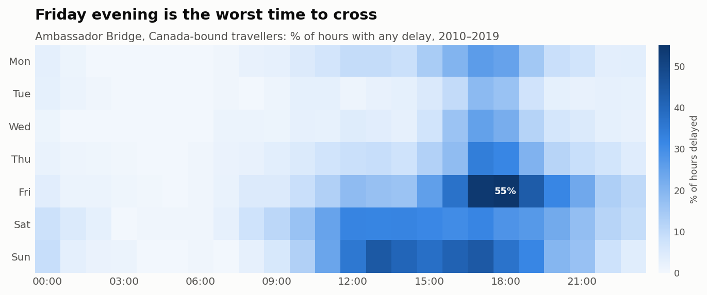
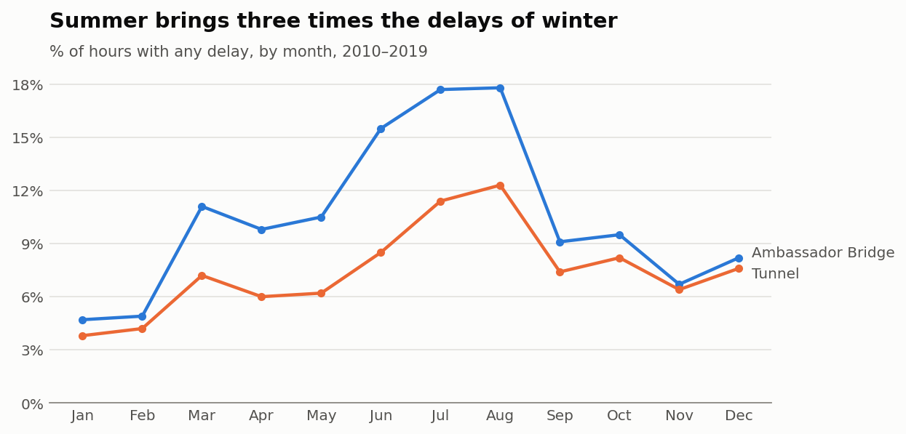
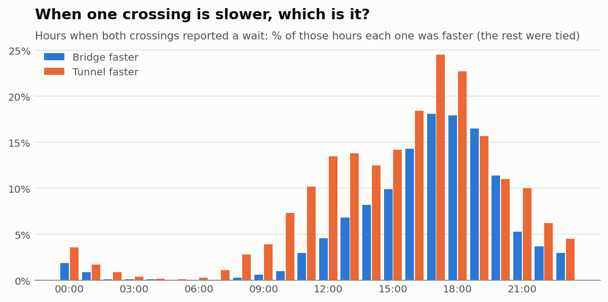
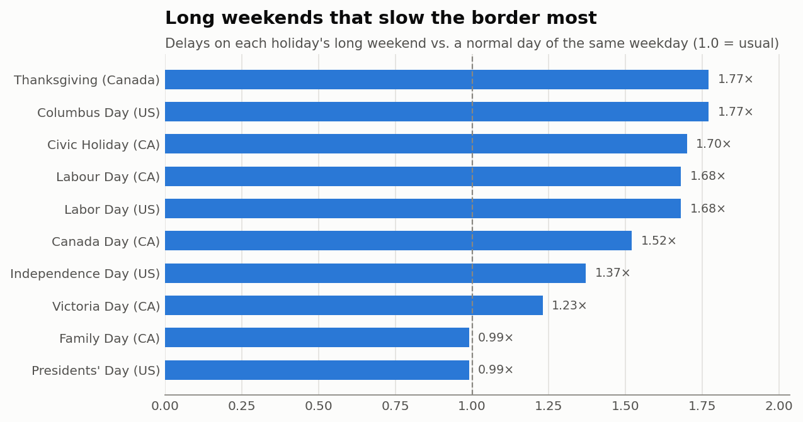
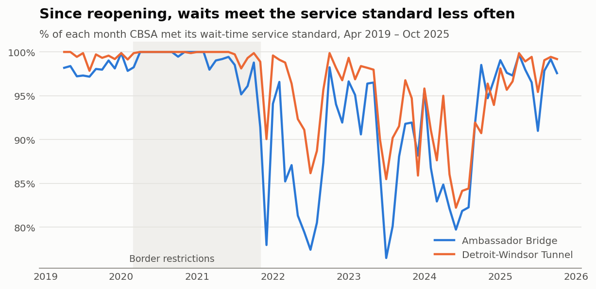

# 🚗 Windsor–Detroit Border Wait Analysis

An analysis of traveller wait times at the two Windsor–Detroit crossings — the **Ambassador Bridge** and the **Detroit–Windsor Tunnel** — using open data published by the Canada Border Services Agency (CBSA).

**153,875 hourly readings · April 2010 – December 2019 · plus monthly service-standard data to October 2025**

Interactive dashboard: [`site/`](site/) — heatmap of delays by day and hour, and a "best time to cross" planner.

## Questions this project answers

- When are the crossings busiest — by hour of day, day of week, and month?
- How do long weekends and holidays affect waits?
- Is the Bridge or the Tunnel faster, and does that change by time of day?
- How did border traffic change before, during, and after COVID-19?

## Key findings

A reading counts as **delayed** when CBSA reported any traveller wait above zero ("No delay" otherwise).

| | Ambassador Bridge | Detroit–Windsor Tunnel |
|---|---|---|
| Hours with a delay | **10.5%** | **7.5%** |
| Average wait when delayed | 16.8 min | 18.3 min |
| Longest reported wait | 120 min | 90 min |
| Delayed on holidays / long weekends | 13.6% (vs 10.2% regular days) | 12.0% (vs 7.0%) |

### 1. Friday evening is the worst time to cross



Friday 6 pm at the Bridge was delayed **55%** of the time, and Friday 5–7 pm holds the top spots at both crossings. Every one of the ten worst hours falls on Friday, Saturday or Sunday between 4 pm and 7 pm. Before 9 am, delays almost never happen.

### 2. Summer is about three times worse than winter



At the Bridge, 17.8% of August hours were delayed compared with 4.7% in January. The Tunnel follows the same pattern (12.3% vs 3.8%).

### 3. At rush hour, the Tunnel is usually the quicker choice



Comparing the two crossings in the same hour, most of the time both had no delay. When they differed at 5 pm, the Tunnel was quicker in 24.5% of hours and the Bridge in 18.1%. Late in the evening (7 pm onward) the gap disappears.

### 4. Long weekends hit the Tunnel hardest



The Tunnel is delayed **1.7×** as often on holidays and long weekends, the Bridge 1.3×. The busiest are Thanksgiving / Columbus Day weekend (**1.77×** the usual rate for that weekday), the Civic Holiday (1.70×) and Labour Day (1.68×). Christmas Day is the quietest, at about half the usual rate.

### 5. Service has not returned to pre-COVID levels



CBSA's monthly figures show the share of time it met its service standard. At the Bridge this fell from an average of **98.1%** before COVID to **90.3%** since the border reopened in November 2021; at the Tunnel from 99.5% to 94.1%.

## Data

All data comes from the Government of Canada Open Data portal (Open Government Licence – Canada):

- [Historical Border Wait Times – Land Mode](https://open.canada.ca/data/en/dataset/000fe5aa-1d77-42d1-bfe7-458c51dacfef)

Raw files are downloaded automatically by a GitHub Actions workflow (`.github/workflows/fetch-data.yml`) using the portal's CKAN API, then filtered to the Windsor crossings.

## Project structure

```
├── scripts/fetch_data.py      # Downloads and filters the open data
├── data/raw/                  # Filtered raw data + manifest (generated)
├── src/border_wait/           # Cleaning and analysis code
└── tests/                     # Tests
```
